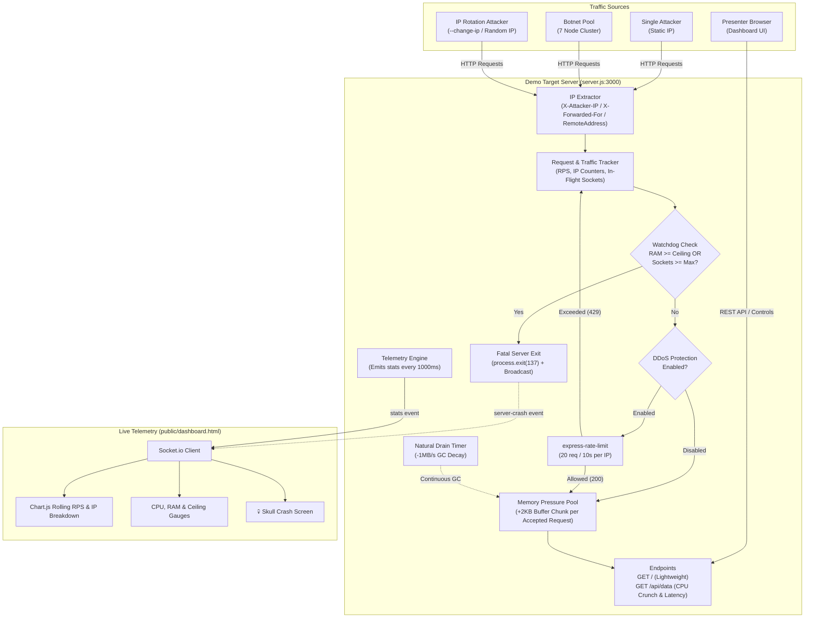
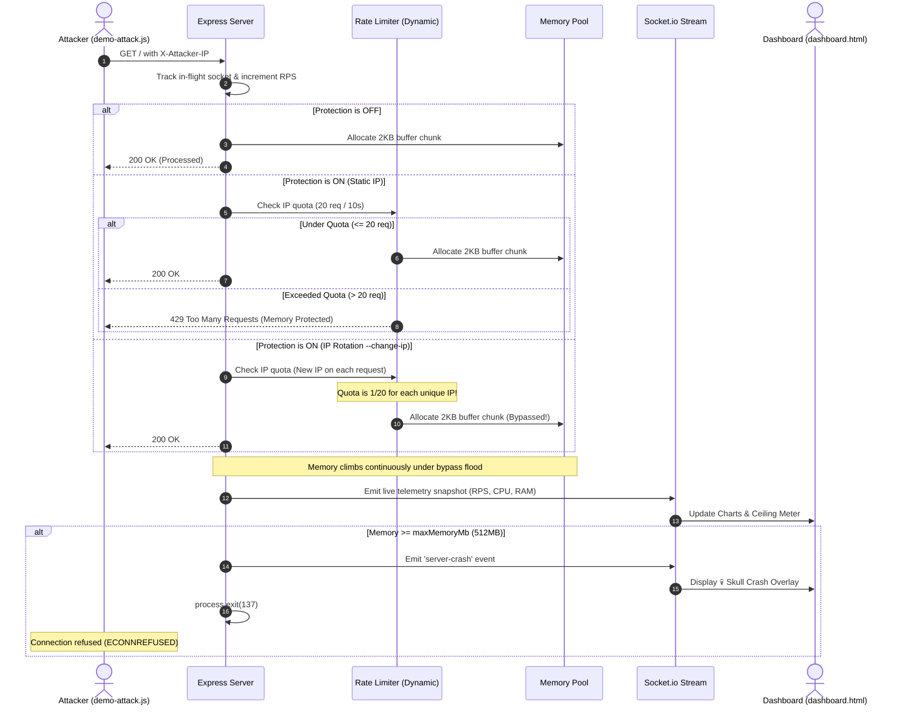

# 🛡️ University DDoS Demonstration Server & Live Telemetry Dashboard

[](https://nodejs.org/)
[](https://expressjs.com/)
[](https://socket.io/)
[](https://tailwindcss.com/)
[](LICENSE)

An educational, interactive Node.js testbed and live telemetry dashboard designed for university lectures, computer science labs, and cybersecurity demonstrations.

This project delivers hands-on, visual demonstrations of **Layer 7 (Application Layer) HTTP flood attacks**, **dynamic runtime rate limiting**, **IP-spoofing and botnet evasion techniques**, and **gradual server resource exhaustion culminating in a fatal Out-Of-Memory (OOM) shutdown**.

---

## 📑 Table of Contents

- [Overview & Educational Objectives](#-overview--educational-objectives)
- [Architecture & Request Lifecycle](#-architecture--request-lifecycle)
- [Key Features](#-key-features)
- [Quick Start](#-quick-start)
- [Attack Scenarios & Demonstration Commands](#-attack-scenarios--demonstration-commands)
- [Live Telemetry Dashboard](#-live-telemetry-dashboard)
- [REST API Reference](#-rest-api-reference)
- [Socket.IO Real-Time Telemetry Protocol](#-socketio-real-time-telemetry-protocol)
- [Attack Script CLI Reference (`demo-attack.js`)](#-attack-script-cli-reference-demo-attackjs)
- [University Classroom Presentation Guide](#-university-classroom-presentation-guide)
- [Why Simple Rate Limiting Fails (Defense-in-Depth)](#-why-simple-rate-limiting-fails-defense-in-depth)
- [Automated Verification Tests](#-automated-verification-tests)
- [Project Structure](#-project-structure)
- [License](#-license)

---

## 🎯 Overview & Educational Objectives

Traditional DDoS demonstrations either crash a server instantaneously or require complex multi-machine lab setups. This repository provides a turnkey, self-contained demonstration environment that runs on a single laptop while illustrating core cybersecurity lessons:

1. **Layer 7 (Application-Layer) Vulnerability**: Understand why HTTP flood attacks are distinct from Layer 3/4 volumetric floods (such as SYN or UDP floods). L7 floods target application processing pipelines, socket tables, and event loop cycles.
2. **Single-Threaded Concurrency Limits**: Observe how Node.js's non-blocking, single-threaded event loop behaves under flood conditions when CPU-intensive or unthrottled work blocks the thread.
3. **Dynamic Mitigation via Rate Limiting**: Toggle defense policies on/off in real time without server restarts and observe immediate transition into `429 Too Many Requests` status codes.
4. **The Botnet / IP Rotation Dilemma**: Discover why standard per-IP rate limiting (`express-rate-limit`) fails against distributed botnets or proxy rotation tools: when an attacker rotates source IPs with each request, each connection appears as an innocent first-time user.
5. **Realistic Runway to OOM Shutdown**: Configured with a default **512 MB** memory ceiling and natural garbage drainage (~1MB/sec), the server does not instantly crash—providing presenters with a **20–45 second window** to explain dashboard metrics as RAM climbs before triggering a fatal crash (`process.exit(137)`).

---

## 🏗️ Architecture & Request Lifecycle



### Request Processing Sequence



---

## 🌟 Key Features

| Capability | Technical Implementation | Educational Benefit |
| :--- | :--- | :--- |
| **Vulnerable by Default** | Single-threaded Node.js event loop, no reverse proxy, no worker clustering. | Demonstrates raw unmitigated server behavior under high concurrency. |
| **Gradual Resource Runway** | Configurable memory ceiling (**512 MB default**) with **2 KB/req allocation** and natural **~1MB/sec background drainage**. | Prevents instant crashes, giving 20–45s of presentation time to observe telemetry. |
| **Fatal Crash Shutdown** | Hard watchdog monitoring process RSS and active sockets; triggers `process.exit(137)`. | Concretely proves when a target goes down; client receives `ECONNREFUSED`. |
| **Dynamic Rate Limiting** | Wrapped `express-rate-limit` middleware toggled via HTTP POST without restarting. | Shows the instant effectiveness of Layer 7 controls against static attackers. |
| **IP-Spoofing / Botnet Bypass** | Header spoofing (`X-Attacker-IP` & `X-Forwarded-For`) randomized per request. | Highlights why per-IP filtering cannot stop distributed botnets. |
| **Live Hardware Telemetry** | Native `os.cpus()` differential tick math and `process.memoryUsage()`. | Displays true system metrics without external monitoring agents. |
| **Event Loop Delay Monitor** | High-resolution 100ms drift watchdog. | Visualizes single-threaded event loop starvation in real time. |
| **Turnkey Dark Dashboard** | Built-in Tailwind CSS + Chart.js dashboard powered by Socket.IO. | Zero frontend build step required; ready immediately at `/dashboard`. |

---

## 🚀 Quick Start

### 1. Prerequisites
- **Node.js**: v18.0.0 or higher
- **npm**: v9.0.0 or higher

### 2. Installation
Clone the repository and install dependencies:
```bash
git clone https://github.com/your-username/DDOS.git
cd DDOS
npm install
```

### 3. Start the Server
```bash
npm start
```
By default, the server initializes with:
- **Port**: `3000`
- **Memory Hard Ceiling**: `512 MB`
- **Max Concurrent Sockets**: `2,000`
- **Mitigation Protection**: `DISABLED` (Undefended)

#### Key Access URLs:
- **Live Visual Dashboard**: [http://localhost:3000/dashboard](http://localhost:3000/dashboard)
- **Target Endpoint (Lightweight)**: [http://localhost:3000/](http://localhost:3000/)
- **Target Endpoint (CPU / DB Heavy)**: [http://localhost:3000/api/data](http://localhost:3000/api/data)
- **REST Telemetry Snapshot**: [http://localhost:3000/api/stats](http://localhost:3000/api/stats)

#### Custom Resource Ceilings at Startup:
```bash
# Faster crash mode (128MB or 256MB)
node server.js --memory 256

# Tank mode (1024MB / 1GB)
node server.js --memory 1024 --max-conn 5000

# Using Environment Variables
PORT=8080 MAX_MEMORY_MB=256 node server.js
```
> [!TIP]
> You can also adjust the memory ceiling at any time from the live dashboard dropdown or via the `/api/set-limits` endpoint without restarting the server!

---

## ⚔️ Attack Scenarios & Demonstration Commands

Open a second terminal window to launch attack scenarios using the bundled `demo-attack.js` utility or npm script shortcuts:

```
┌────────────────────────────────────────────────────────────────────────────┐
│                             ATTACK SCENARIOS                               │
├──────────┬─────────────────────────┬───────────────────┬───────────────────┤
│ Scenario │ Command                 │ Protection OFF    │ Protection ON     │
├──────────┼─────────────────────────┼───────────────────┼───────────────────┤
│ A        │ npm run attack          │ High RPS (200 OK) │ Blocked (429)     │
│ B        │ npm run attack:botnet   │ Multi-IP Traffic  │ Blocked per Node  │
│ C        │ npm run attack:bypass   │ High RPS (200 OK) │ 💥 BYPASS & CRASH │
│ D        │ npm run attack:heavy    │ Event Loop Freeze │ Event Loop Freeze │
└──────────┴─────────────────────────┴───────────────────┴───────────────────┘
```

### Scenario A: Single Attacker (Static IP)
Simulates a classic DoS attack originated by a single machine:
```bash
npm run attack
# Or: node demo-attack.js
```
- **When Protection is OFF**: The target server processes all incoming requests as `200 OK`. CPU and memory climb.
- **When Protection is ON**: After exactly 20 requests in a 10-second window, the attacker is blocked with `429 Too Many Requests`. Server memory is completely safeguarded.

---

### Scenario B: Distributed Botnet Simulation (Fixed 7-Node Pool)
Simulates a coordinated botnet composed of 7 compromised zombie hosts (e.g., IoT devices, CCTV cameras, compromised servers):
```bash
npm run attack:botnet
# Or: node demo-attack.js --botnet
```
- **Dashboard Observation**: Observe the **Source IP Distribution** bar chart on the dashboard. Traffic is divided across:
  - `172.20.0.2 (Bot-Alpha)`
  - `172.20.0.3 (Bot-Bravo)`
  - `172.20.0.4 (Bot-Charlie)`
  - `172.20.0.5 (Bot-Delta)`
  - `172.20.0.6 (Bot-Echo)`
  - `192.168.10.15 (Compromised-IoT)`
  - `192.168.10.22 (Compromised-CCTV)`
- **When Protection is ON**: Each bot node gets up to 20 requests before being individually throttled with `429`.

---

### Scenario C: IP-Rotation Bypass (Surpassing Rate Limiting & OOM Crash)
Demonstrates the fundamental limitation of per-IP rate limiting when confronted with dynamic proxy rotation or IP spoofing:
```bash
npm run attack:bypass
# Or: npm run attack:change-ip
# Or: node demo-attack.js --change-ip --concurrency 25
```
- **Why this completely bypasses rate limiting**:
  1. The attack generator creates a distinct public IPv4 address for every request.
  2. Because each request arrives from a new IP, `express-rate-limit` records a count of `1 / 20` for each IP.
  3. No individual IP ever triggers the 20-request threshold.
  4. **100% of attack requests pass through as HTTP 200 OK**, completely neutralizing the rate limiter!
  5. The server's memory buffer pool accumulates 2 KB per accepted request.
  6. Over 20–45 seconds, the memory ceiling gauge climbs: `20%` ➔ `50%` ➔ `80%` ➔ `100%`.
  7. **💥 Fatal Crash**: Upon breaching 512 MB, the server terminates (`process.exit(137)`).
  8. The dashboard flashes the **💀 Target Server Has Crashed** overlay, and the attack terminal logs `TARGET DOWN (ECONNREFUSED)`.

---

### Scenario D: Heavy Compute & Database Latency Exhaustion
Targets the computationally expensive `/api/data` endpoint, which simulates CPU-intensive hashing (300,000 trigonometric operations) and asynchronous database latency:
```bash
npm run attack:heavy
# Or with IP rotation:
npm run attack:change-ip:heavy
# Or: node demo-attack.js --endpoint /api/data --concurrency 15
```
- **Dashboard Observation**:
  - The **Node Event Loop Delay** card spikes from `0ms` to hundreds or thousands of milliseconds.
  - The single-threaded Node.js event loop blocks, delaying responses and timing out client connections.

---

## 🖥️ Live Telemetry Dashboard

The built-in dashboard is served directly by the server at [http://localhost:3000/dashboard](http://localhost:3000/dashboard).

```
┌──────────────────────────────────────────────────────────────────────────────────┐
│  🟢 DDoS Live Telemetry & Defense Dashboard                 [512 MB ▼] [🛡️ ON]  │
├──────────────────────────────────────────────────────────────────────────────────┤
│  [  Total Traffic  ]  [   Blocked 429   ]  [  Memory Ceiling  ]  [   CPU Usage  ]│
│       1,450 req/s          1,200 dropped          384 / 512 MB            84.5%  │
│       Total: 42,000        Since active: 8.4k      [████████░░] 75%       Thread │
├───────────────────────────────────────────────────────┬──────────────────────────┤
│  📈 Real-time Traffic Timeline (RPS vs 429 Blocked)    │  📊 Source IP Breakdown  │
│  ───────────────────────────────────────────────────  │  ──────────────────────  │
│  2000 ┤        /\                                     │  Bot-Alpha  ████████ 320 │
│  1000 ┤  /\   /  \    (Green: 200 OK)                 │  Bot-Bravo  ███████  290 │
│     0 ┼──--\-/----\-- (Red: 429 Blocked)             │  Comp-IoT   ████████ 310 │
└───────────────────────────────────────────────────────┴──────────────────────────┘
```

### Dashboard Components

1. **Memory Ceiling Selector Dropdown**:
   - Change memory limits on the fly between **128 MB** (Fast Crash), **256 MB** (Quick), **512 MB** (Presentation Default), and **1024 MB** (Tank Mode) without restarting.
2. **Mitigation Toggle Button**:
   - One-click toggle between **Undefended Mode** and **DDoS Protection Active**.
3. **Simulate Crash Button**:
   - Immediately triggers the crash handler for quick lecture wrap-ups without running an attack flood.
4. **Metric Cards**:
   - **Total Traffic**: Instantaneous Requests per Second (RPS) and cumulative counter.
   - **Blocked (429s)**: Total dropped requests since protection was enabled.
   - **Memory Ceiling Meter**: Current process RSS vs. the configured limit, with an animated color-coded progress bar (Green ➔ Amber ➔ Red).
   - **CPU Usage**: System-wide CPU utilization percentage based on CPU tick deltas.
   - **Event Loop Delay**: Node.js thread lag in milliseconds.
   - **In-Flight Sockets**: Number of currently active TCP requests vs. socket capacity.
5. **Real-time Charts**:
   - **Traffic Timeline Chart**: Rolling 30-second multi-dataset line chart comparing accepted requests (200 OK) vs. blocked requests (429).
   - **Source IP Breakdown Chart**: Real-time bar chart showing the distribution of requests across client IP addresses.
6. **Fatal Crash Modal**:
   - Triggered via the Socket.io `server-crash` event when the server process shuts down. Displays the exact crash cause and an educational summary explaining why rate limiting was defeated.

---

## 📡 REST API Reference

All endpoints accept and return JSON (with CORS enabled for all origins).

### `GET /`
Lightweight home route and standard flood target.
- **Response `200 OK`**:
```json
{
  "service": "University DDoS Demo Server",
  "status": "online",
  "path": "/",
  "description": "Target endpoint. Under DDoS flood, this server will struggle when unprotected.",
  "protectionEnabled": false,
  "clientIp": "127.0.0.1",
  "memoryLimitMb": 512,
  "timestamp": "2026-11-17T07:00:00.000Z"
}
```

---

### `GET /api/data`
Simulates a resource-intensive endpoint performing 300,000 synchronous math calculations and a 20ms simulated database query.
- **Response `200 OK`**:
```json
{
  "status": "success",
  "endpoint": "/api/data",
  "simulatedOperation": "CPU Hash + Database Query",
  "executionTimeMs": "4.12ms",
  "clientIp": "127.0.0.1",
  "data": [
    { "id": 1, "item": "Research Dataset Alpha", "sizeKb": 142 },
    { "id": 2, "item": "Student Registry Records", "sizeKb": 890 },
    { "id": 3, "item": "Exam Grades Database", "sizeKb": 54 }
  ]
}
```

---

### `POST /api/toggle-protection`
Enables or disables dynamic rate limiting at runtime.
- **Request Body (Optional)**:
```json
{ "enabled": true }
```
*(If body is empty, toggles current state).*
- **Response `200 OK`**:
```json
{
  "success": true,
  "protectionEnabled": true,
  "blockedSinceProtection": 0,
  "toggledAt": "2026-11-17T07:05:00.000Z",
  "message": "DDoS Protection ENABLED (Rate Limit: 20 req / 10s)"
}
```

---

### `POST /api/set-limits`
Dynamically adjusts memory and socket thresholds.
- **Request Body**:
```json
{
  "maxMemoryMb": 1024,
  "maxConcurrentConn": 3000
}
```
- **Response `200 OK`**:
```json
{
  "success": true,
  "maxMemoryMb": 1024,
  "maxConcurrentConn": 3000,
  "message": "Resource limits updated: Memory ceiling = 1024MB, Concurrency ceiling = 3000"
}
```

---

### `POST /api/crash`
Immediately forces a fatal resource exhaustion crash (useful during lectures).
- **Response `200 OK`**:
```json
{
  "message": "Triggering fatal resource exhaustion crash..."
}
```

---

### `POST /api/reset-memory`
Clears accumulated memory buffer allocations back to baseline.
- **Response `200 OK`**:
```json
{
  "success": true,
  "message": "Memory pressure pool reset",
  "currentRssMb": 42.5
}
```

---

### `GET /api/stats`
Non-WebSocket fallback returning the full telemetry snapshot.
- **Query Parameter**: `?internal=true` (avoids inflating traffic counters).
- **Response `200 OK`**:
```json
{
  "timestamp": 1731826800000,
  "protectionEnabled": false,
  "cpuPercent": 14.2,
  "ramPercent": 52.1,
  "ramUsedMb": 8192,
  "ramTotalMb": 16384,
  "processRssMb": 65.4,
  "maxMemoryMb": 512,
  "memoryCeilingPercent": 12.8,
  "requestsPerSecondTotal": 1420,
  "requestsPerSecondByIp": {
    "127.0.0.1": 1420
  },
  "blockedRequests": 0,
  "totalBlockedCumulative": 0,
  "totalRequestsCumulative": 15420,
  "activeConnections": 18,
  "maxConcurrentConnections": 2000,
  "eventLoopLagMs": 2,
  "isCrashing": false
}
```

---

## 🔌 Socket.IO Real-Time Telemetry Protocol

The dashboard connects to Socket.IO on the same host and port. The server emits events on connection and on a 1-second interval.

### Server-to-Client Events

| Event | Frequency | Payload Description |
| :--- | :--- | :--- |
| `initial-state` | Once upon connection | Server configuration, current protection status, limits, and uptime. |
| `stats` | Every 1,000 ms | Comprehensive telemetry dictionary (CPU, RAM, RPS, IP map, lag). |
| `protection-change` | On state toggle | Notifies all clients when rate limiting is turned ON or OFF. |
| `limits-updated` | On limit update | Transmits updated `maxMemoryMb` or `maxConcurrentConn`. |
| `server-crash` | Instantaneous on OOM | Broadcasts crash alert and reason before process termination. |

#### Sample `stats` Event Payload:
```json
{
  "timestamp": 1731826801000,
  "cpuPercent": 48.6,
  "ramPercent": 61.2,
  "ramUsedMb": 9800,
  "ramTotalMb": 16000,
  "processRssMb": 210.4,
  "maxMemoryMb": 512,
  "memoryCeilingPercent": 41.1,
  "totalRps": 1850,
  "rpsByIp": {
    "192.168.1.10": 450,
    "192.168.1.11": 420,
    "192.168.1.12": 490,
    "192.168.1.13": 490
  },
  "blockedRequests": 0,
  "totalBlockedCumulative": 0,
  "totalRequestsCumulative": 45200,
  "activeConnections": 25,
  "maxConcurrentConnections": 2000,
  "protectionEnabled": false,
  "eventLoopLagMs": 3,
  "isCrashing": false
}
```

---

## 🛠️ Attack Script CLI Reference (`demo-attack.js`)

The attack generator script is fully customizable via command-line arguments:

```bash
node demo-attack.js [options]
```

### Supported CLI Flags

| Flag | Aliases | Default | Description |
| :--- | :--- | :--- | :--- |
| `--host` | *-* | `127.0.0.1` | Target hostname or IP. |
| `--port` | *-* | `3000` | Target port. |
| `--endpoint` | *-* | `/` | Target path (e.g., `/` or `/api/data`). |
| `--concurrency`| *-* | `20` (or `25` in bypass mode) | Number of simultaneous HTTP client worker loops. |
| `--duration` | *-* | `0` (runs until Ctrl+C) | Auto-stop after specified duration in seconds. |
| `--change-ip` | `--change-ips`, `--ip-change`, `--ip-changing`, `--random-ip`, `--random-ips`, `--rotate-ip`, `--rotate-ips`, `--spoof-ip`, `-c` | `false` | Enables IP-spoofing and IP-rotation mode to surpass per-IP rate limits. |
| `--change-every`| `--rotate-every` | `1` | Number of requests before rotating to a new IP address. |
| `--botnet` | *-* | `false` | Simulates a fixed 7-node botnet pool with distinct source IP names. |

### Advanced Attack Examples

```bash
# High-concurrency IP-rotation attack against heavy endpoint for 30 seconds
node demo-attack.js --change-ip --endpoint /api/data --concurrency 40 --duration 30

# Rotate IP every 15 requests (demonstrating threshold edge behavior)
node demo-attack.js --change-ip --change-every 15

# Target remote demonstration server
node demo-attack.js --host 192.168.1.50 --port 3000 --change-ip
```

---

## 🎓 University Classroom Presentation Guide

Follow this 5-to-10 minute presentation guide for a classroom lecture or lab:

```
┌─────────────────────────────────────────────────────────────────────────────┐
│                       CLASSROOM PRESENTATION TIMELINE                       │
├─────────┬───────────────────────────────────┬───────────────────────────────┤
│ Minute  │ Action                            │ Core Concept Demonstrated     │
├─────────┼───────────────────────────────────┼───────────────────────────────┤
│ 00 - 02 │ Baseline & Single Attacker        │ Layer 7 Traffic vs Idle State │
│ 02 - 04 │ Enable Protection (Mitigation ON) │ Effective Per-IP Mitigation   │
│ 04 - 07 │ Launch IP Rotation Attack         │ Rate Limit Evasion & Botnets  │
│ 07 - 08 │ Observe Resource Creep            │ Memory Accumulation & Runway  │
│ 08 - 09 │ Fatal Crash Event (Server Down)   │ OOM Termination (Exit 137)    │
│ 09 - 10 │ Debrief & Real-World Solutions    │ Multi-Layered Defense         │
└─────────┴───────────────────────────────────┴───────────────────────────────┘
```

### Detailed Script

#### 1. Phase 1: Baseline State (Minutes 00–02)
- Start the server: `npm start`.
- Open [http://localhost:3000/dashboard](http://localhost:3000/dashboard) on the classroom projector.
- **Talking Points**:
  - Point to the memory gauge: baseline RSS is ~40–50 MB (<10% of the 512 MB ceiling).
  - Note that Node.js uses a single-threaded event loop.
  - Launch a basic flood in terminal 2: `npm run attack`.
  - Show how RPS jumps to ~1,000–2,000 req/s with 100% `200 OK`.

#### 2. Phase 2: Dynamic Mitigation (Minutes 02–04)
- Click the **"Enable DDoS Protection"** button on the dashboard.
- **Talking Points**:
  - The banner switches to green (`DDoS Protection Active`).
  - Within seconds, the accepted RPS drops to zero, and the **Blocked (429s)** counter surges.
  - Explain the standard rule: 20 requests per 10 seconds per IP address.
  - Highlight that server memory is completely stable and protected from exhaustion.
  - Stop the attack in terminal 2 with `Ctrl+C`.

#### 3. Phase 3: The Botnet Dilemma & Rate Limit Bypass (Minutes 04–07)
- Ask students: *"Does simple rate limiting solve DDoS in the real world?"*
- Keep protection **ENABLED** on the dashboard.
- In terminal 2, execute the IP-rotation attack:
  ```bash
  npm run attack:bypass
  ```
- **Talking Points**:
  - Point to the dashboard: blocked requests remain at **0 dropped**!
  - Every request is arriving with status `200 OK`.
  - Explain why: attackers control thousands of compromised devices (botnets) or rotate commercial proxies.
  - Because each request has a different source IP, `express-rate-limit` sees each one as a new, legitimate client.

#### 4. Phase 4: Gradual Resource Runway & Fatal Crash (Minutes 07–09)
- Draw attention to the **Memory Ceiling progress meter**:
  - Watch it steadily climb: 30% ➔ 50% ➔ 70% ➔ 90%.
  - Explain that unmitigated connections consume buffers and session descriptors.
  - Emphasize the ~1MB/sec natural recovery drainage, showing that sustained flood is required to defeat the server.
- **The Climax**:
  - As memory reaches 512 MB, the watchdog triggers `process.exit(137)`.
  - The projector screen displays the full-screen **💀 Target Server Has Crashed** modal.
  - The attack terminal outputs: `💀 [TARGET IS DOWN!] Connection Refused (ECONNREFUSED)`.

#### 5. Phase 5: Debrief & Recovery (Minutes 09–10)
- Review the post-crash lesson box displayed on the screen.
- Restart the server for the next demonstration: `npm start`.

---

## 🛡️ Why Simple Rate Limiting Fails (Defense-in-Depth)

In real-world infrastructure, per-IP rate limiting is only the first line of defense. The table below illustrates why layered security is necessary:

| Defense Layer | How It Works | Vulnerability / Bypass | Modern Production Mitigation |
| :--- | :--- | :--- | :--- |
| **Naive Per-IP Rate Limiting** | Tracks requests per IP address in memory or Redis. | Easily bypassed via botnets, proxy rotation, or spoofed headers. | Behavioral fingerprinting, ASN aggregation. |
| **Reverse Proxy / Edge WAF** | Terminates TLS and filters traffic at Cloudflare, CloudFront, or Fastly. | High-volume Layer 7 floods can still bypass if origin IP is exposed. | Origin shield, authenticated origin pulls, WAF managed rules. |
| **Interactive Challenges** | Issues CAPTCHA or invisible JavaScript proof-of-work challenges. | Can impact legitimate user experience on APIs or mobile apps. | Non-interactive turnstile challenges, token-based API authentication. |
| **Client Fingerprinting** | Analyzes TLS Client Hello (JA3/JA4), HTTP/2 settings, and header order. | Advanced botnets mimic real browser TLS stacks (e.g., via headless Chrome). | Device attestation, behavioral velocity analysis. |
| **Autoscaling & Clustering** | Spawns multiple worker processes across Kubernetes pods. | Increases infrastructure costs; unmitigated floods can scale costs exponentially. | Rate limiting combined with upstream caching and CDN edge termination. |

---

## 🧪 Automated Verification Tests

A comprehensive verification test suite (`test-server.js`) verifies all components, endpoints, Socket.IO broadcasts, rate limiting behavior, and IP-rotation bypass:

### Running the Test Suite
Ensure the server is running on port 3000, then execute:
```bash
npm test
```

### What the Tests Verify:
1. `GET /` — Verifies HTTP 200 and initial service health.
2. `GET /api/data` — Validates CPU hash workload and payload structure.
3. `GET /dashboard` — Verifies delivery of the HTML interface.
4. `GET /api/stats` — Verifies CPU, RAM, and ceiling telemetry properties.
5. `Socket.io Events` — Connects a client to confirm `initial-state` and periodic `stats` broadcasts.
6. `POST /api/toggle-protection` — Verifies dynamic toggle to `enabled: true` and Socket.io event propagation.
7. `Single IP Quota Enforcement` — Sends 25 requests from a single IP and asserts that exactly 20 are accepted and 5 are blocked with `429`.
8. `IP-Rotation Bypass` — Sends 25 requests with randomized source IPs and asserts that 100% are accepted with `200 OK` (0 blocked).
9. `POST /api/reset-memory` — Verifies memory pool cleanup endpoint.
10. `POST /api/toggle-protection` — Returns protection to `enabled: false`.

---

## 📁 Project Structure

```
DDOS/
├── server.js            # Express server with telemetry, dynamic rate limiting, and OOM watchdog
├── demo-attack.js       # CLI attack generator (single, botnet, and IP-spoofing bypass modes)
├── test-server.js       # Automated end-to-end verification test suite
├── package.json         # Project metadata, dependencies, and npm run scripts
├── README.md            # Comprehensive documentation & classroom presentation guide
└── public/
    └── dashboard.html   # Real-time Tailwind CSS + Chart.js dashboard with Socket.io client
```

---

## 📄 License

This project is licensed under the [MIT License](LICENSE). It is intended strictly for educational, defensive, and authorized testing purposes.
