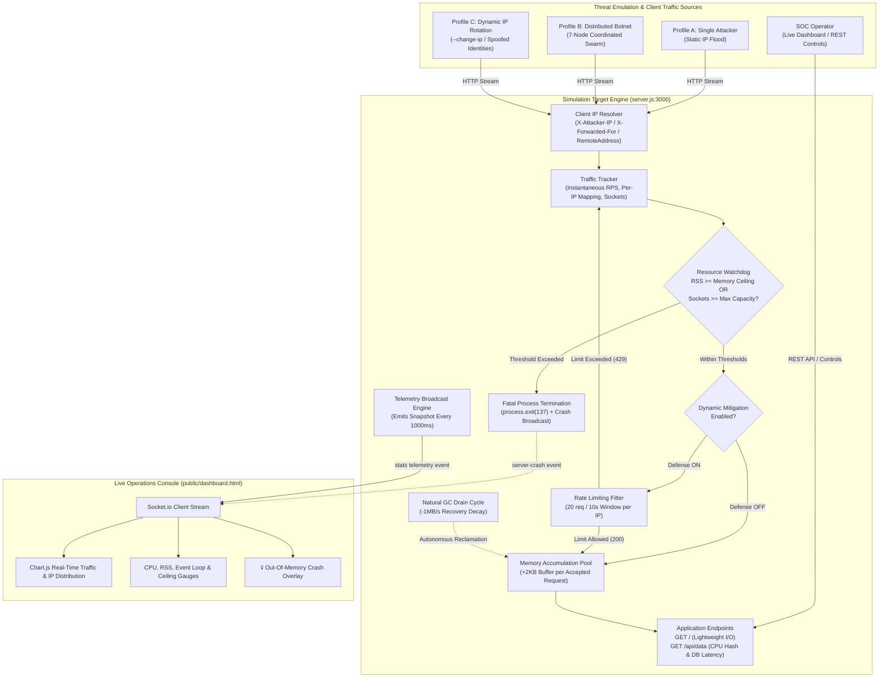
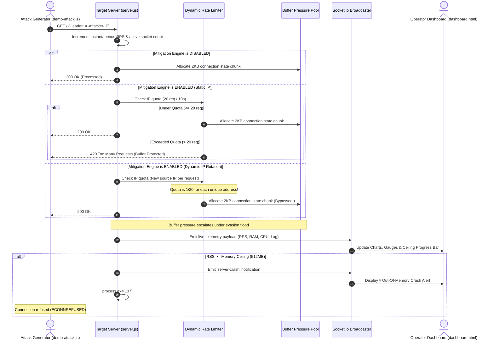

# ⚡ Layer 7 DDoS Attack & Defense Simulation Engine

[](https://nodejs.org/)
[](https://expressjs.com/)
[](https://socket.io/)
[](https://tailwindcss.com/)
[](LICENSE)
[](https://github.com/)

A high-fidelity, real-time **Layer 7 (Application Layer) DDoS simulation sandbox**, threat emulation harness, and live telemetry operations console.

This simulation framework allows security engineers, red/blue teams, and systems architects to benchmark **application-layer volumetric floods**, evaluate **dynamic runtime rate-limiting policies**, analyze **botnet IP rotation & evasion tactics**, and observe **deterministic server resource exhaustion culminating in a fatal Out-Of-Memory (OOM) crash**.

---

## 📑 Table of Contents

- [Simulation Overview & Engineering Goals](#-simulation-overview--engineering-goals)
- [Simulation Architecture & Data Pipeline](#-simulation-architecture--data-pipeline)
- [Core Simulation Capabilities](#-core-simulation-capabilities)
- [Quick Start & Sandbox Deployment](#-quick-start--sandbox-deployment)
- [Threat Emulation Profiles & Attack Scenarios](#-threat-emulation-profiles--attack-scenarios)
- [Live Operator Dashboard (SOC Console)](#-live-operator-dashboard-soc-console)
- [REST Control & Inspection API](#-rest-control--inspection-api)
- [Socket.IO Real-Time Telemetry Protocol](#-socketio-real-time-telemetry-protocol)
- [Traffic Generator CLI Reference (`demo-attack.js`)](#-traffic-generator-cli-reference-demo-attackjs)
- [Simulation Playbook & Operator Runbook](#-simulation-playbook--operator-runbook)
- [Threat Intelligence & Defense-in-Depth Analysis](#-threat-intelligence--defense-in-depth-analysis)
- [Automated Verification & Test Harness](#-automated-verification--test-harness)
- [Repository Structure](#-repository-structure)
- [License](#-license)

---

## 🎯 Simulation Overview & Engineering Goals

Modern Layer 7 DDoS attacks do not rely on raw network-bandwidth exhaustion (e.g., volumetric SYN or UDP reflection floods). Instead, they exploit application-layer semantics—consuming CPU cycles, exhaustion of socket pools, event-loop starvation, and unreleased buffer memory.

This simulation environment provides a reproducible, instrumentation-rich harness to model:

1. **Application-Layer Asymmetric Floods**: Generate high-velocity HTTP traffic that saturates Node.js's single-threaded event loop and socket queues without requiring multi-gigabit hardware.
2. **Dynamic Mitigation Efficacy**: Test runtime activation of rate-limiting filters (`express-rate-limit`) without service restarts, measuring the drop curve from `200 OK` to `429 Too Many Requests`.
3. **Botnet Evasion Dynamics**: Emulate distributed botnet clusters and dynamic proxy rotation (`--change-ip`). Demonstrate why naive per-IP counters fail against adversaries that distribute requests across rotating source identities.
4. **Gradual Resource Degradation & Deterministic OOM**: Simulate connection buffer retention (2 KB allocated per accepted request) balanced against continuous natural garbage drainage (~1MB/sec). Under sustained evasion flood, this provides an observable **20–45 second degradation runway** before the server watchdog triggers a hard exit (`process.exit(137)`).
5. **Full Telemetry Observability**: Continuously capture and stream CPU utilization, resident memory (RSS), event loop delay, per-IP traffic distribution, and socket pressure to an interactive operations dashboard via WebSockets.

---

## 🏗️ Simulation Architecture & Data Pipeline



### Telemetry & Request Lifecycle



---

## 🌟 Core Simulation Capabilities

| Capability | Technical Mechanism | Simulation Purpose |
| :--- | :--- | :--- |
| **Vulnerable Baseline Architecture** | Single-threaded Node.js event loop with unclustered HTTP processing. | Demonstrates baseline application behavior under unmitigated concurrency. |
| **Gradual Resource Degradation** | Configurable memory ceiling (**512 MB default**) with **16–32 KB/req allocation** and **~1.5MB/sec background drainage**. | Configured for high-throughput testing; allows fast or gradual runs (10–30s) to observe telemetry. |
| **Deterministic Failure Simulation** | Watchdog monitors RSS memory and active sockets; triggers `process.exit(137)`. | Accurately models container/OS OOM termination; clients experience `ECONNREFUSED`. |
| **Dynamic Layer 7 Mitigation** | Wrapped `express-rate-limit` middleware toggled via API or UI at runtime. | Benchmarks the immediate protective effect of rate limiting against static sources. |
| **Botnet / Identity Rotation Evasion** | Header spoofing (`X-Attacker-IP` & `X-Forwarded-For`) randomized per request. | Highlights why per-IP filtering fails against distributed botnets or proxy pools. |
| **Hardware Telemetry Instrumentation** | Differential tick measurement (`os.cpus()`) and `process.memoryUsage()`. | Delivers high-precision CPU and memory telemetry without external APM agents. |
| **Event Loop Starvation Monitor** | High-resolution 100ms drift watchdog. | Measures event loop blocking when compute-heavy operations lock the single thread. |
| **Turnkey Dark Operations Console** | Embedded Tailwind CSS + Chart.js frontend powered by Socket.IO. | Real-time visual interface ready instantly at `/dashboard` with zero compilation. |

---

## 🚀 Quick Start & Sandbox Deployment

### 1. Prerequisites
- **Node.js**: v18.0.0 or higher
- **npm**: v9.0.0 or higher

### 2. Installation
Clone the repository and install dependencies:
```bash
git clone https://github.com/mohamedfo17/DDOS.git
cd DDOS
npm install
```

### 3. Start the Simulation Engine
```bash
npm start
```
The simulation engine initializes with standard benchmark defaults:
- **Port**: `3000`
- **Memory Ceiling**: `512 MB` (Configurable: 128MB, 256MB, 512MB, 1024MB)
- **Max Concurrent Sockets**: `2,000`
- **Mitigation State**: `DISABLED` (Undefended Target)

#### Endpoint Map:
- **Live Operations Console**: [http://localhost:3000/dashboard](http://localhost:3000/dashboard)
- **Target Endpoint (Lightweight Flood)**: [http://localhost:3000/](http://localhost:3000/)
- **Target Endpoint (CPU / Async Starvation)**: [http://localhost:3000/api/data](http://localhost:3000/api/data)
- **REST Telemetry Polling Endpoint**: [http://localhost:3000/api/stats](http://localhost:3000/api/stats)

#### Customizing Resource Limits at Launch:
```bash
# Fast failure profile (256MB ceiling)
node server.js --memory 256

# High-capacity benchmark (1024MB ceiling, 5,000 socket capacity)
node server.js --memory 1024 --max-conn 5000

# Using Environment Variables
PORT=8080 MAX_MEMORY_MB=256 node server.js
```
> [!TIP]
> The memory ceiling can also be updated dynamically at runtime via the dashboard dropdown or the `/api/set-limits` REST endpoint without restarting the engine!

---

## ⚔️ Threat Emulation Profiles & Attack Scenarios

Run attack scenarios using `demo-attack.js` or the predefined npm script profiles:

```
┌────────────────────────────────────────────────────────────────────────────┐
│                       THREAT EMULATION PROFILES                            │
├──────────┬─────────────────────────┬───────────────────┬───────────────────┤
│ Profile  │ Command                 │ Mitigation OFF    │ Mitigation ON     │
├──────────┼─────────────────────────┼───────────────────┼───────────────────┤
│ A        │ npm run attack          │ High RPS (200 OK) │ Blocked (429)     │
│ B        │ npm run attack:botnet   │ Distributed Flood │ Throttled per Node│
│ C        │ npm run attack:bypass   │ High RPS (200 OK) │ 💥 BYPASS & CRASH │
│ Turbo    │ npm run attack:turbo    │ Max RPS (200 OK)  │ ⚡ RAPID CRASH (<15s)│
│ D        │ npm run attack:heavy    │ Event Loop Freeze │ Event Loop Freeze │
└──────────┴─────────────────────────┴───────────────────┴───────────────────┘
```

### Profile A: Static IP Volumetric Flood
Simulates a high-rate Layer 7 flood originating from a single fixed source IP:
```bash
npm run attack
# Or: node demo-attack.js
```
- **When Mitigation is OFF**: All incoming requests return `200 OK`. RPS spikes, and memory pressure accumulates.
- **When Mitigation is ON**: After exactly 20 requests in a 10-second window, subsequent requests are dropped with `429 Too Many Requests`. Target memory remains completely protected.

---

### Profile B: Distributed Botnet Simulation (7-Node Cluster)
Simulates a coordinated botnet swarm distributing traffic across a pool of compromised nodes:
```bash
npm run attack:botnet
# Or: node demo-attack.js --botnet
```
- **Console Observation**: The **Source IP Breakdown** chart visualizes concurrent traffic from 7 discrete nodes:
  - `172.20.0.2 (Bot-Alpha)`
  - `172.20.0.3 (Bot-Bravo)`
  - `172.20.0.4 (Bot-Charlie)`
  - `172.20.0.5 (Bot-Delta)`
  - `172.20.0.6 (Bot-Echo)`
  - `192.168.10.15 (Compromised-IoT)`
  - `192.168.10.22 (Compromised-CCTV)`
- **When Mitigation is ON**: Each bot node is throttled independently once its individual 20-request quota is reached.

---

### Profile C: Dynamic IP Rotation & Evasion (Surpassing Rate Limits & OOM Crash)
Emulates an adversary utilizing dynamic proxy networks, botnet clusters, or IPv4 address rotation:
```bash
npm run attack:bypass
# Or: npm run attack:change-ip
# Or: node demo-attack.js --change-ip
```
- **Why this completely evades standard rate limiting**:
  1. The traffic generator randomizes the client IP address on every request.
  2. Because each request arrives from an unrecorded IP, `express-rate-limit` assigns it a count of `1 / 20`.
  3. No single IP ever breaches the threshold.
  4. **100% of attack requests pass through as HTTP 200 OK**, rendering simple per-IP rate limiting ineffective.
  5. The target engine allocates 16 KB of buffer memory for every accepted request.
  6. Over 15–30 seconds, the memory gauge climbs: `20%` ➔ `50%` ➔ `80%` ➔ `100%`.
  7. **💥 Fatal Process Termination**: Upon exceeding 512 MB, the watchdog triggers `process.exit(137)`.
  8. The operator console displays the **💀 Target Server Has Crashed** overlay, and the attack CLI reports `TARGET DOWN (ECONNREFUSED)`.

---

### Profile Turbo: High-Velocity Rapid Failure (Under 15 Seconds)
For rapid testing or stress demonstrations where you need immediate memory ceiling saturation:
```bash
npm run attack:turbo
# Or: node demo-attack.js --change-ip --turbo
```
- **How Turbo mode accelerates exhaustion**:
  - Launches with **120 concurrent workers** (generating 3,000–6,000+ RPS).
  - Transmits `X-Attack-Intensity: 32` header, causing the engine to allocate **32 KB** per accepted request.
  - At 3,000+ req/s, memory fills at **~96 MB/sec**, crashing the 512 MB server within **5–10 seconds**!

---

### Profile D: Algorithmic Complexity / Asymmetric Resource Starvation
Directs traffic against the computationally intensive `/api/data` endpoint, which simulates CPU-intensive hashing (300,000 trigonometric operations) and a 20ms asynchronous database query:
```bash
npm run attack:heavy
# Or with dynamic IP rotation:
npm run attack:change-ip:heavy
# Or: node demo-attack.js --endpoint /api/data --concurrency 15
```
- **Console Observation**:
  - The **Node Event Loop Delay** metric surges from `0ms` to hundreds of milliseconds.
  - The single-threaded execution model is blocked, resulting in connection timeouts and latency degradation.

---

## 🖥️ Live Operator Dashboard (SOC Console)

The simulation engine serves an integrated real-time operations console at [http://localhost:3000/dashboard](http://localhost:3000/dashboard).

```
┌──────────────────────────────────────────────────────────────────────────────────┐
│  🟢 DDoS Live Telemetry & Defense Dashboard                 [512 MB ▼] [🛡️ ON]  │
├──────────────────────────────────────────────────────────────────────────────────┤
│  [  Total Traffic  ]  [   Blocked 429   ]  [  Memory Ceiling  ]  [   CPU Usage  ]│
│       1,450 req/s          1,200 dropped          384 / 512 MB            84.5%  │
│       Total: 42,000        Since active: 8.4k      [████████░░] 75%       Thread │
├───────────────────────────────────────────────────────┬──────────────────────────┤
│  📈 Real-time Traffic Timeline (RPS vs 429 Blocked)    │  📊 Source IP Breakdown  │
│  ───────────────────────────────────────────────────  │  ──────────────────────  │
│  2000 ┤        /\                                     │  Bot-Alpha  ████████ 320 │
│  1000 ┤  /\   /  \    (Green: 200 OK)                 │  Bot-Bravo  ███████  290 │
│     0 ┼──--\-/----\-- (Red: 429 Blocked)             │  Comp-IoT   ████████ 310 │
└───────────────────────────────────────────────────────┴──────────────────────────┘
```

### Console Components & Telemetry Widgets

1. **Memory Ceiling Selector**:
   - Change memory limits on the fly between **128 MB** (Fast Crash), **256 MB** (Quick), **512 MB** (Standard Benchmark), and **1024 MB** (High-Capacity Tank Mode).
2. **Attack Pressure / Allocation Weight Selector**:
   - Adjust the per-request buffer allocation on the fly: **4 KB (Gentle)**, **8 KB (Light)**, **16 KB (Standard)**, **32 KB (⚡ Turbo)**, or **64 KB (💥 Extreme)** without restarting.
3. **Mitigation Engine Toggle**:
   - One-click live toggle between **Undefended Mode** and **DDoS Protection Active**.
4. **Interactive Attack Launcher (In-Browser)**:
   - Launch test floods directly from the dashboard: **1. Static IP Flood**, **2. IP Changing Flood**, or **3. ⚡ Turbo Evasion Flood (Rapid Crash in <15s)**.
5. **Simulate Crash Button**:
   - Instantly triggers the watchdog crash handler for rapid scenario teardowns.
6. **Telemetry Metric Cards**:
   - **Total Traffic**: Instantaneous Requests per Second (RPS) and cumulative request counter.
   - **Blocked (429s)**: Total dropped requests since mitigation was activated.
   - **Memory Ceiling Meter**: Current process RSS vs. the configured ceiling, with an animated color-coded progress meter (Green ➔ Amber ➔ Red).
   - **CPU Usage**: System-wide CPU utilization percentage based on differential tick sampling.
   - **Event Loop Delay**: Node.js thread lag in milliseconds.
   - **In-Flight Sockets**: Number of currently active TCP sockets vs. socket capacity.
5. **Real-Time Data Visualizations**:
   - **Traffic Timeline Chart**: Rolling 30-second multi-dataset line chart tracking accepted requests (`200 OK`) against dropped requests (`429`).
   - **Source IP Breakdown Chart**: Real-time bar chart showing traffic distribution across client IP addresses.
6. **Fatal Crash Modal**:
   - Triggered via the Socket.io `server-crash` event when the engine terminates. Details the exact failure cause and provides an architectural analysis of why rate limiting was bypassed.

---

## 📡 REST Control & Inspection API

All endpoints communicate via JSON and have CORS enabled for external client integration.

### `GET /`
Lightweight benchmark endpoint and primary volumetric flood target.
- **Response `200 OK`**:
```json
{
  "service": "Layer 7 DDoS Simulation Server",
  "status": "online",
  "path": "/",
  "description": "Target endpoint. Under DDoS flood, this server will struggle when unprotected.",
  "protectionEnabled": false,
  "clientIp": "127.0.0.1",
  "memoryLimitMb": 512,
  "timestamp": "2026-11-19T08:00:00.000Z"
}
```

---

### `GET /api/data`
Simulates an asymmetric resource-heavy endpoint executing 300,000 synchronous math operations and an asynchronous 20ms database query.
- **Response `200 OK`**:
```json
{
  "status": "success",
  "endpoint": "/api/data",
  "simulatedOperation": "CPU Hash + Database Query",
  "executionTimeMs": "4.12ms",
  "clientIp": "127.0.0.1",
  "data": [
    { "id": 1, "item": "Research Dataset Alpha", "sizeKb": 142 },
    { "id": 2, "item": "User Account Records", "sizeKb": 890 },
    { "id": 3, "item": "Exam Grades Database", "sizeKb": 54 }
  ]
}
```

---

### `POST /api/toggle-protection`
Dynamically activates or deactivates the rate-limiting filter at runtime.
- **Request Body (Optional)**:
```json
{ "enabled": true }
```
*(If body is omitted, toggles current state).*
- **Response `200 OK`**:
```json
{
  "success": true,
  "protectionEnabled": true,
  "blockedSinceProtection": 0,
  "toggledAt": "2026-11-19T08:05:00.000Z",
  "message": "DDoS Protection ENABLED (Rate Limit: 20 req / 10s)"
}
```

---

### `POST /api/set-limits`
Dynamically adjusts memory and socket thresholds during active simulations.
- **Request Body**:
```json
{
  "maxMemoryMb": 1024,
  "maxConcurrentConn": 3000
}
```
- **Response `200 OK`**:
```json
{
  "success": true,
  "maxMemoryMb": 1024,
  "maxConcurrentConn": 3000,
  "message": "Resource limits updated: Memory ceiling = 1024MB, Concurrency ceiling = 3000"
}
```

---

### `POST /api/crash`
Immediately triggers a fatal resource exhaustion crash for rapid testing.
- **Response `200 OK`**:
```json
{
  "message": "Triggering fatal resource exhaustion crash..."
}
```

---

### `POST /api/reset-memory`
Flushes the accumulated memory buffer pool back to baseline.
- **Response `200 OK`**:
```json
{
  "success": true,
  "message": "Memory pressure pool reset",
  "currentRssMb": 42.5
}
```

---

### `GET /api/stats`
Retrieves a complete instantaneous telemetry snapshot (polling alternative to WebSockets).
- **Query Parameter**: `?internal=true` (prevents self-polling from inflating traffic counts).
- **Response `200 OK`**:
```json
{
  "timestamp": 1732003200000,
  "protectionEnabled": false,
  "cpuPercent": 24.5,
  "ramPercent": 54.2,
  "ramUsedMb": 8680,
  "ramTotalMb": 16384,
  "processRssMb": 72.1,
  "maxMemoryMb": 512,
  "memoryCeilingPercent": 14.1,
  "requestsPerSecondTotal": 1280,
  "requestsPerSecondByIp": {
    "127.0.0.1": 1280
  },
  "blockedRequests": 0,
  "totalBlockedCumulative": 0,
  "totalRequestsCumulative": 12800,
  "activeConnections": 15,
  "maxConcurrentConnections": 2000,
  "eventLoopLagMs": 2,
  "isCrashing": false
}
```

---

## 🔌 Socket.IO Real-Time Telemetry Protocol

The console establishes a persistent WebSocket connection to receive live telemetry frames and state transitions.

### Event Catalog

| Event | Direction | Frequency | Payload Description |
| :--- | :--- | :--- | :--- |
| `initial-state` | Server ➔ Client | Upon connection | Baseline engine limits, current mitigation state, and uptime. |
| `stats` | Server ➔ Client | Every 1,000 ms | Comprehensive telemetry dictionary (CPU, RAM, RPS, IP map, lag). |
| `protection-change` | Server ➔ Client | State transition | Broadcast when mitigation is enabled or disabled. |
| `limits-updated` | Server ➔ Client | Limit modification| Broadcast when memory or socket capacity is updated. |
| `server-crash` | Server ➔ Client | Instantaneous | Broadcast before process termination detailing failure cause. |

#### Sample `stats` Telemetry Frame:
```json
{
  "timestamp": 1732003201000,
  "cpuPercent": 52.4,
  "ramPercent": 62.1,
  "ramUsedMb": 9940,
  "ramTotalMb": 16000,
  "processRssMb": 235.6,
  "maxMemoryMb": 512,
  "memoryCeilingPercent": 46.0,
  "totalRps": 1920,
  "rpsByIp": {
    "192.168.1.10": 480,
    "192.168.1.11": 460,
    "192.168.1.12": 490,
    "192.168.1.13": 490
  },
  "blockedRequests": 0,
  "totalBlockedCumulative": 0,
  "totalRequestsCumulative": 38400,
  "activeConnections": 22,
  "maxConcurrentConnections": 2000,
  "protectionEnabled": false,
  "eventLoopLagMs": 3,
  "isCrashing": false
}
```

---

## 🛠️ Traffic Generator CLI Reference (`demo-attack.js`)

The bundled traffic generator tool (`demo-attack.js`) provides high-velocity traffic generation with customizable concurrency and evasion settings:

```bash
node demo-attack.js [options]
```

### CLI Flag Reference

| Flag | Aliases | Default | Description |
| :--- | :--- | :--- | :--- |
| `--host` | *-* | `127.0.0.1` | Target simulation host. |
| `--port` | *-* | `3000` | Target simulation port. |
| `--endpoint` | *-* | `/` | Target path (`/` or `/api/data`). |
| `--turbo` | `--fast`, `-t` | `false` | Turbo acceleration: 120 concurrency + 32KB/req allocation weight. |
| `--intensity`| *-* | `16` (or `32` in turbo) | Memory pressure weight per request in KB (`X-Attack-Intensity`). |
| `--concurrency`| *-* | `40` (or `60` in bypass, `120` in turbo) | Number of simultaneous HTTP client worker loops. |
| `--duration` | *-* | `0` (runs until Ctrl+C) | Auto-terminate after specified duration in seconds. |
| `--change-ip` | `--change-ips`, `--ip-change`, `--ip-changing`, `--random-ip`, `--random-ips`, `--rotate-ip`, `--rotate-ips`, `--spoof-ip`, `-c` | `false` | Enables IP-spoofing and IP-rotation mode to surpass per-IP rate limits. |
| `--change-every`| `--rotate-every` | `1` | Number of requests to send before rotating to a new IP address. |
| `--botnet` | *-* | `false` | Distributes requests across a fixed 7-node botnet pool. |

### Advanced Generator Invocations

```bash
# Maximum-velocity turbo evasion attack (hits ceiling in ~5-10s)
npm run attack:turbo
# Or: node demo-attack.js --change-ip --turbo

# Custom high-concurrency attack (150 workers, 64KB memory weight)
node demo-attack.js --change-ip --concurrency 150 --intensity 64

# High-concurrency IP-rotation attack on heavy endpoint for 30 seconds
node demo-attack.js --change-ip --endpoint /api/data --concurrency 80 --duration 30

# Rotate IP every 10 requests (testing rate-limiter threshold behavior)
node demo-attack.js --change-ip --change-every 10

# Direct attack against remote testbed server
node demo-attack.js --host 10.0.0.15 --port 3000 --change-ip
```

---

## 📋 Simulation Playbook & Operator Runbook

Follow this structured playbook to run a complete end-to-end attack, defense, evasion, and failure simulation:

```
┌─────────────────────────────────────────────────────────────────────────────┐
│                          SIMULATION RUNBOOK PHASES                          │
├─────────┬───────────────────────────────────┬───────────────────────────────┤
│ Phase   │ Scenario Action                   │ Evaluated Metric / Behavior   │
├─────────┼───────────────────────────────────┼───────────────────────────────┤
│ Phase 1 │ Baseline Establishment            │ Idle Resource Profile         │
│ Phase 2 │ Unmitigated Volumetric Flood      │ Event Loop & RPS Throughput   │
│ Phase 3 │ Dynamic Mitigation Engagement     │ 429 Drop Rate & Protection    │
│ Phase 4 │ Botnet Identity Rotation Evasion  │ Rate-Limit Bypass Dynamics    │
│ Phase 5 │ Resource Runway & Failure Event   │ OOM Watchdog Shutdown (137)   │
│ Phase 6 │ Environment Teardown & Recovery   │ Service Restart (`npm start`) │
└─────────┴───────────────────────────────────┴───────────────────────────────┘
```

### Step-by-Step Operator Instructions

#### 1. Phase 1: Baseline Establishment
- Launch the target engine: `npm start`.
- Open [http://localhost:3000/dashboard](http://localhost:3000/dashboard) in a browser.
- **Verification**:
  - Memory consumption is stable at baseline (~40–50 MB, <10% of the 512 MB ceiling).
  - CPU utilization is near 0%, and event loop delay is ~0ms.

#### 2. Phase 2: Unmitigated Volumetric Flood
- In a separate terminal, launch a static volumetric flood:
  ```bash
  npm run attack
  ```
- **Observed Behavior**:
  - Total traffic surges to 1,000–2,000 req/s with 100% `200 OK` status codes.
  - Active sockets increase, and CPU utilization rises.

#### 3. Phase 3: Dynamic Mitigation Engagement
- Click the **"Enable DDoS Protection"** button on the dashboard.
- **Observed Behavior**:
  - The banner switches to green (`DDoS Protection Active`).
  - Accepted RPS drops to zero, and the **Blocked (429s)** counter increases rapidly.
  - Rate limiting caps the attacker at 20 requests per 10-second window.
  - Target memory remains stable and protected.
  - Terminate the attack with `Ctrl+C`.

#### 4. Phase 4: Botnet Identity Rotation Evasion
- Ensure mitigation remains **ENABLED**.
- In the attack terminal, launch the IP-rotation evasion attack:
  ```bash
  npm run attack:bypass
  ```
- **Observed Behavior**:
  - Blocked requests remain flat at **0 dropped**!
  - 100% of attack requests pass through as `200 OK`.
  - Because each request presents a novel source IP address, the rate-limiting counter never reaches 20 for any single identity.

#### 5. Phase 5: Resource Runway & Failure Event
- Monitor the **Memory Ceiling Meter** on the console:
  - Watch the memory pool climb: 30% ➔ 50% ➔ 70% ➔ 90%.
  - Observe how the ~1MB/sec natural drainage prevents instant crashes, demonstrating the need for sustained volumetric pressure.
- **Failure Event**:
  - Once RSS crosses 512 MB, the engine watchdog triggers `process.exit(137)`.
  - The console displays the **💀 Target Server Has Crashed** overlay.
  - The attack generator reports: `💀 [TARGET IS DOWN!] Connection Refused (ECONNREFUSED)`.

#### 6. Phase 6: Recovery
- Return to terminal 1 and restart the simulation engine: `npm start`.

---

## 🛡️ Threat Intelligence & Defense-in-Depth Analysis

This simulation highlights why static, per-IP rate limiting cannot serve as a standalone defense against distributed threat actors:

| Defense Tier | Mechanism | Evasion / Weakness | Production-Grade Countermeasure |
| :--- | :--- | :--- | :--- |
| **Per-IP Rate Limiting** | Counts requests per IP in memory or Redis. | Trivial to bypass using proxy rotation, botnets, or spoofed headers. | Behavioral velocity rules, ASN-wide rate limits. |
| **Reverse Proxy / Edge WAF** | Terminates TLS and scrubs traffic at edge points (Cloudflare, AWS CloudFront). | Origin IP disclosure permits direct attacks bypassing the edge. | Authenticated origin pulls (mTLS), strict ingress firewalling. |
| **Interactive Challenges** | Issues CAPTCHA or cryptographic proof-of-work puzzles. | Can degrade legitimate user experience on mobile and API endpoints. | Managed non-interactive turnstile challenges, token attestation. |
| **TLS / Header Fingerprinting** | Evaluates JA3/JA4 fingerprints and HTTP/2 parameter order. | Advanced botnets mimic modern browser TLS handshakes (e.g. via headless engines). | Browser integrity attestation, mouse/keyboard entropy checks. |
| **Autoscaling / Clustering** | Dynamically provisions worker containers behind load balancers. | Increases infrastructure costs; unmitigated floods can cause financial exhaustion. | Edge caching combined with aggressive origin shielding. |

---

## 🧪 Automated Verification & Test Harness

The repository includes an end-to-end verification test suite (`test-server.js`) that automatically validates endpoint functionality, Socket.IO telemetry, rate-limiting rules, and IP-rotation evasion:

### Executing the Test Suite
Ensure the engine is running on port 3000, then execute:
```bash
npm test
```

### Verified Assertions:
1. `GET /` — Validates HTTP 200 and baseline response structure.
2. `GET /api/data` — Confirms execution of CPU hash calculations and asynchronous data retrieval.
3. `GET /dashboard` — Verifies delivery of the operations console interface.
4. `GET /api/stats` — Asserts presence of CPU, RAM, and ceiling telemetry properties.
5. `Socket.io Streaming` — Validates reception of `initial-state` and periodic `stats` telemetry frames.
6. `POST /api/toggle-protection` — Verifies dynamic activation of mitigation and event broadcasting.
7. `Single IP Rate Enforcement` — Emits 25 requests from a static IP; confirms exactly 20 are accepted and 5 are blocked with `429`.
8. `IP-Rotation Bypass Verification` — Emits 25 requests with randomized source IPs; asserts that 100% are accepted with `200 OK` (0 blocked).
9. `POST /api/reset-memory` — Confirms memory pool flush functionality.
10. `POST /api/toggle-protection` — Returns mitigation state to `enabled: false`.

---

## 📁 Repository Structure

```
DDOS/
├── server.js            # Target engine with dynamic rate limiting, telemetry, and OOM watchdog
├── demo-attack.js       # High-velocity traffic generator (single, botnet, and IP-rotation modes)
├── test-server.js       # End-to-end automated verification test harness
├── package.json         # Dependency configuration and simulation run scripts
├── README.md            # Simulation framework documentation and operator playbook
└── public/
    └── dashboard.html   # Real-time Tailwind CSS + Chart.js operations console with Socket.io
```

---

## 📄 License

This simulation framework is licensed under the [MIT License](LICENSE). It is intended strictly for authorized security research, defensive testing, resilience simulation, and engineering evaluation.
